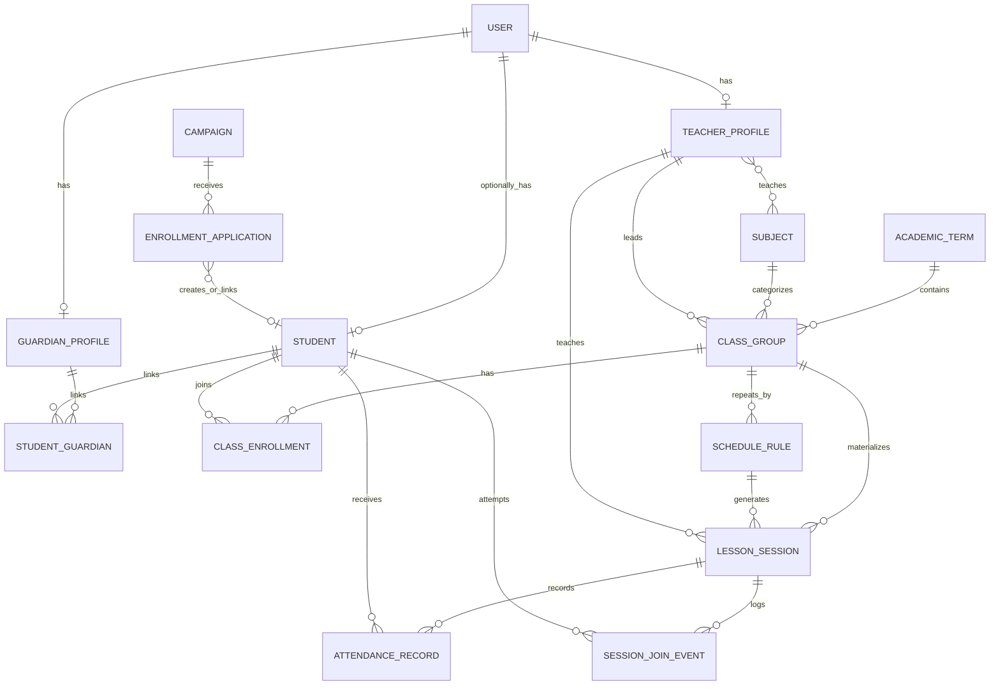

# Backend Implementation Plan

Status: proposed MVP architecture; Phases 0 and 2 plus an initial admin integration slice implemented on 2026-08-27  
Audience: backend implementers, frontend implementers, and future coding agents  
Repository reviewed: the current React/Vite admin dashboard in this repository  
Backend target: a lightweight Django monolith serving a versioned REST API

## 1. Executive summary

Build one Django REST Framework application beside the existing frontend. The backend should cover this operating flow:

1. An owner or administrator creates an enrollment campaign and configures its public form.
2. A parent, guardian, or student submits the form without needing an account.
3. An administrator reviews the application and creates or links the student and guardian records.
4. An owner or administrator invites teachers and records their subjects and recurring availability.
5. An administrator creates a class group, assigns a teacher, enrolls students, and defines a recurring schedule.
6. The backend materializes the schedule into dated lesson sessions. Those sessions power the calendar and timetable.
7. A teacher supplies the meeting URL and later records attendance for each lesson session.
8. An enrolled student, or a linked guardian acting for that student, can open a session during the allowed join window. The backend records the join attempt and returns the meeting URL.
9. Financial status may be visible as pending, but it must not block class access in this release.

In this plan, **self-enrollment** means that a student or guardian submits the public campaign form themselves. It does not mean that an unreviewed public user can place themselves directly into an active class. Administrators retain control of acceptance, grouping, and scheduling.

The most important domain distinction is:

- A **class group** is the ongoing teaching arrangement: subject, teacher, enrolled students, term, and normal timetable.
- A **lesson session** is one dated occurrence of that class: for example, Mathematics on 2026-09-02 from 16:00 to 17:00.

Attendance, joining, cancellations, substitutions, and actual teaching records belong to lesson sessions, not directly to the class group.

Calendar and timetable are read projections over schedule rules and lesson sessions. They do not need separate database models.

### Implementation progress

The repository currently contains:

- Completed Phase 0 scaffold and configuration.
- Completed Phase 2 browser authentication, invitations, role enforcement, CSRF, throttling, and token-revocation tests.
- The custom user seam, foundational student/guardian/teacher/subject/term/class/schedule models, and initial migrations.
- Cookie-backed JWT login and owner/admin authorization.
- Live React pages for dashboard totals, students, teachers, classes, and the recurring weekly calendar.
- Student creation and teacher invitation modals, a public invitation-acceptance page, and a three-step class wizard.
- Role-specific teacher and student portals with server-scoped classes, weekly timetables, and dashboard summaries.
- Explicit one-to-one student login linkage issued from the admin Students page.
- Initial billing slice: invoices, receipts, mock refunds/reconciliation, restrictions, and a PayHero STK-prompt adapter with tokenized callbacks. PayHero remains opt-in; teacher payouts, provider-side refunds, and automated reconciliation are not implemented.

This is still a deliberately narrow vertical slice across later phases, not a declaration that Phases 1, 3, 4, or 5 are complete. Campaign applications, availability/conflict checks, dated lesson sessions, the Attend action, and attendance are still outstanding in their documented phases.

## 2. What the current frontend implies

The frontend began as a presentation shell; the implemented admin, teacher, and student pages now use the Django API. The remaining placeholder pages imply the following backend capabilities:

| Frontend area | Implied backend data or action |
| --- | --- |
| Login | Authenticated user, display name, and role |
| Dashboard | Active student count, classes this week, attendance today, and recent activity |
| Students | Student, guardian, grade, status, and join date |
| Teachers | Teacher, subjects, assigned classes, and status |
| Classes | Class name, teacher, schedule, meeting-link readiness, and enrollment count |
| Calendar | Dated lesson sessions across a week or date range |
| Attendance | Student, lesson/class, teacher, attendance status, and recorded time |
| Payments | Invoices, payment attempts, receipts, payment prompts, and balance visibility; see the billing handoff |
| Reports | Attendance export can be implemented later; payment and teacher-earnings reports remain deferred |
| Settings | Organization identity, timezone, term dates, join window, and eventually notifications/payments |

The current login combines `parent` and `student` in one UI option. The backend should not combine them: one guardian may be responsible for multiple students, and some students may not have their own account.

## 3. MVP scope

### In scope

- One organization per deployment
- Owner, administrator, teacher, guardian, and student roles
- JWT-based login, refresh, logout, invitations, and current-user endpoint
- Public enrollment campaigns with a small configurable form definition
- Enrollment application review and acceptance
- Student, guardian, teacher, subject, and teacher-availability records
- Academic terms
- Class groups and student enrollment in those groups
- Recurring timetable rules
- Generated lesson sessions for calendar views
- Meeting-link management
- Secure join action and join-event logging
- Teacher-recorded attendance
- Role-scoped dashboard summaries
- Invoices, payment attempts, receipts, late-payment restrictions, mock payment/refund workflows, and optional PayHero STK prompts
- Django Admin for operational fallback
- API schema, automated tests, structured logs, and production configuration

### Explicitly out of scope

- Automatic teacher payments and payout batches
- Provider-side PayHero refunds and automated provider reconciliation
- Automatic teacher-to-student matching or optimization
- Video-meeting creation through Zoom, Google Meet, or Teams APIs
- Capturing actual call duration from a meeting provider
- SMS, WhatsApp, push, or scheduled reminder delivery
- A general-purpose form builder with arbitrary branching logic
- Multi-organization tenancy
- A separate microservice architecture
- Redis, Celery, and a message broker for the initial release

### Small financial placeholder

`ClassEnrollment` may carry a manual `financial_status`, nullable `balance_due`, and currency. This exists only so the UI can say that a balance is pending. It is not a ledger and it must never be used to deny the join action.

## 4. Assumptions chosen so implementation can start

These defaults are intentionally explicit. They can be changed before implementation without redesigning the whole backend.

1. This deployment serves one organization. Do not add an `organization_id` to every table yet.
2. Store timestamps in UTC and render them using the organization timezone. Default timezone: `Africa/Nairobi`.
3. Use email as the login identifier. Phone numbers are profile/contact data, not usernames.
4. A guardian may be linked to many students, and a student may have multiple guardians.
5. A student account is optional. A guardian account can view and join classes on behalf of a linked student.
6. Owners and administrators create teacher accounts by invitation. There is no public teacher registration.
7. Public campaign submission creates an application, not an active account and not a class enrollment.
8. Accepting an application creates or links people records. An administrator then places the student into a class.
9. Teacher availability is advisory scheduling data. The backend prevents obvious conflicts but does not automatically find the best teacher.
10. One primary teacher is assigned to a class group. A session can override that teacher for substitution.
11. A class can have more than one weekly schedule rule.
12. Meeting URLs are provider-neutral HTTPS URLs entered by the assigned teacher or an administrator.
13. Clicking **Attend** logs intent to join; it does not prove attendance. The teacher remains the authority for final attendance.
14. A default join window opens 15 minutes before the session and closes 30 minutes after its scheduled end. Make both values organization settings.
15. No hard delete is exposed for operational records. Use statuses such as archived, withdrawn, or cancelled.

## 5. Recommended technical stack

Use a conventional synchronous Django application:

- Python 3.12 or 3.13
- Django 5.2 LTS, pinned to the latest security patch in the 5.2 series
- Django REST Framework
- `djangorestframework-simplejwt`
- `django-cors-headers`
- `django-filter`
- `drf-spectacular` for OpenAPI
- PostgreSQL in production and CI
- SQLite only as an optional zero-setup local mode
- `psycopg` for PostgreSQL
- Gunicorn for the first production deployment
- `pytest`, `pytest-django`, and `factory-boy` for tests
- Ruff for formatting and linting

Django 5.2 is an LTS line, and Django recommends PostgreSQL for production. See the official [Django 5.2 release notes](https://docs.djangoproject.com/en/5.2/releases/5.2/) and [installation FAQ](https://docs.djangoproject.com/en/5.2/faq/install/). DRF authentication selects the request identity before permission and throttling checks, while object-level access still has to be implemented explicitly; see the official [authentication](https://www.django-rest-framework.org/api-guide/authentication/) and [permissions](https://www.django-rest-framework.org/api-guide/permissions/) guides.

Do not add Celery at the start. Session generation can happen synchronously when a class schedule is saved, and email can use Django's console backend in development. Add a worker only when real notification delivery, payment webhooks, or high-volume jobs require it.

## 6. Repository layout

Keep the frontend where it is and add a self-contained `backend/` directory:

```text
utility-in-life-dashboard/
├── backend/
│   ├── manage.py
│   ├── pyproject.toml
│   ├── .env.example
│   ├── config/
│   │   ├── settings/
│   │   │   ├── base.py
│   │   │   ├── local.py
│   │   │   ├── test.py
│   │   │   └── production.py
│   │   ├── urls.py
│   │   ├── asgi.py
│   │   └── wsgi.py
│   ├── apps/
│   │   ├── core/
│   │   ├── accounts/
│   │   ├── campaigns/
│   │   └── academics/
│   └── tests/
├── docs/
└── src/
```

Keep the number of Django apps small:

- `core`: shared base model, organization settings, health endpoint, audit/activity event, common exceptions.
- `accounts`: custom user, roles, invitations, guardians, students, and teachers.
- `campaigns`: public campaigns, form configuration, and enrollment applications.
- `academics`: subjects, terms, availability, classes, schedules, sessions, enrollments, join events, and attendance.

Avoid a generic `utils.py`. Put business operations in named modules such as `academics/services/session_generation.py` and `campaigns/services/accept_application.py`.

## 7. Domain model

### Relationship overview



### Shared fields

Use an abstract `TimeStampedModel` for domain records:

- `id`: UUID primary key
- `created_at`: timezone-aware timestamp
- `updated_at`: timezone-aware timestamp

UUIDs make public identifiers less guessable. They do not replace authorization.

### `OrganizationSettings`

Treat this as a singleton edited by owners/admins.

| Field | Notes |
| --- | --- |
| `name` | Organization display name |
| `timezone` | IANA name; default `Africa/Nairobi` |
| `default_currency` | Default `KES` |
| `join_window_before_minutes` | Default `15` |
| `join_window_after_minutes` | Default `30` |
| `contact_email`, `contact_phone` | Optional |

Enforce a single row in application code and expose it through `/api/v1/settings/organization/`.

### `User`

Create the custom user model before the first migration. Subclass `AbstractUser` and remove username login.

| Field | Notes |
| --- | --- |
| `email` | Required, normalized, unique, login identifier |
| `first_name`, `last_name` | Required for staff; optional during invite until accepted |
| `role` | `OWNER`, `ADMIN`, `TEACHER`, `GUARDIAN`, `STUDENT` |
| `phone` | Optional |
| `is_active` | Login access flag |
| `must_change_password` | Useful for temporary setup flows |

Do not trust the role claim in a token as the only authority. Load the user and apply current database role and object relationships on every request.

Normalize email addresses in the user manager and enforce case-insensitive uniqueness at the database level so `Name@example.com` and `name@example.com` cannot become separate accounts.

### `UserInvitation`

| Field | Notes |
| --- | --- |
| `email` | Invite destination |
| `role` | Only admin, teacher, guardian, or student; owner creation is a controlled management operation |
| `token_digest` | Hash the raw one-time token; never store it in plaintext |
| `expires_at` | Short expiry, for example 48 hours |
| `accepted_at` | Null until accepted |
| `invited_by` | Owner/admin actor |

The acceptance endpoint sets the password and activates the account. Resending invalidates older unaccepted tokens.

### `GuardianProfile`

| Field | Notes |
| --- | --- |
| `user` | One-to-one with a `GUARDIAN` user |
| `preferred_contact_method` | Optional enum |

Keep personal contact fields primarily on `User` to avoid duplication.

### `Student`

| Field | Notes |
| --- | --- |
| `user` | Nullable one-to-one with a `STUDENT` user |
| `first_name`, `last_name` | Required even if no user exists |
| `date_of_birth` | Nullable until collected; restrict visibility |
| `grade_level` | Short string for MVP |
| `status` | `PENDING`, `ACTIVE`, `INACTIVE`, `ALUMNI` |
| `joined_at` | Date admitted to the organization |
| `notes` | Admin-only, optional |

Do not derive student identity from a guardian email. Siblings need distinct student records.

### `StudentGuardian`

This through model implements the many-to-many relationship.

| Field | Notes |
| --- | --- |
| `student` | Student |
| `guardian` | Guardian profile |
| `relationship` | Parent, guardian, sibling, other |
| `is_primary` | Primary operational contact |
| `can_manage_classes` | Whether this guardian may join/view classes for the student |

Add a unique constraint on `(student, guardian)`.

### `TeacherProfile`

| Field | Notes |
| --- | --- |
| `user` | One-to-one with a `TEACHER` user |
| `staff_code` | Optional unique human-readable code |
| `bio` | Optional |
| `status` | `INVITED`, `ACTIVE`, `INACTIVE` |

Do not include pay rate or earnings in the MVP. The frontend's earnings column should display `—` or be removed until payroll exists.

### `Subject` and `TeacherSubject`

`Subject` fields: `name`, unique `code`, and `is_active`.

Use a `TeacherSubject` through model with `(teacher, subject)` uniqueness. It may later hold qualification metadata without changing the relationship.

### `TeacherAvailability`

Recurring weekly availability is enough for the first scheduler.

| Field | Notes |
| --- | --- |
| `teacher` | Teacher profile |
| `weekday` | Integer `0` through `6`, Monday first |
| `start_time`, `end_time` | Local wall time |
| `timezone` | Defaults to organization timezone |
| `valid_from`, `valid_until` | Optional date bounds |
| `is_active` | Status flag |

Validate `end_time > start_time`. Overnight slots are out of scope. Add a later `TeacherUnavailability` exception model only when real leave/blackout handling is needed.

### `EnrollmentCampaign`

| Field | Notes |
| --- | --- |
| `name` | Internal/display name |
| `slug` | Unique public identifier |
| `description` | Public text |
| `status` | `DRAFT`, `OPEN`, `CLOSED`, `ARCHIVED` |
| `opens_at`, `closes_at` | Optional bounds |
| `form_schema` | Validated JSON list of additional fields |
| `form_version` | Increment when the form schema changes |
| `created_by` | Owner/admin |

Core fields such as guardian name, guardian email/phone, student name, grade, and requested subjects should be first-class serializer inputs. Use `form_schema` only for extra questions.

Allowed extra field types should be deliberately narrow: `short_text`, `long_text`, `date`, `single_select`, `multi_select`, `boolean`. Each definition may contain `key`, `label`, `type`, `required`, and, where applicable, `options`. Reject unknown types and duplicate keys. Never interpret executable code or HTML from the schema.

### `EnrollmentApplication`

| Field | Notes |
| --- | --- |
| `campaign` | Source campaign |
| `status` | `SUBMITTED`, `UNDER_REVIEW`, `ACCEPTED`, `REJECTED`, `WITHDRAWN` |
| `guardian_name`, `guardian_email`, `guardian_phone` | Normalized core values |
| `student_first_name`, `student_last_name` | Normalized core values |
| `student_date_of_birth`, `grade_level` | Optional/core values |
| `requested_subjects` | Many-to-many to subjects, or normalized IDs captured by serializer |
| `availability_notes` | Free text for initial manual scheduling |
| `extra_answers` | JSON matching the campaign schema |
| `form_version` | Campaign version used for submission |
| `review_notes` | Admin-only |
| `reviewed_by`, `reviewed_at` | Audit fields |
| `resulting_student` | Nullable link after acceptance |

Acceptance must run in one database transaction and be idempotent. Repeating an accepted request returns the existing result rather than creating a duplicate student.

### `AcademicTerm`

| Field | Notes |
| --- | --- |
| `name` | For example `Term 3 2026` |
| `starts_on`, `ends_on` | Inclusive dates |
| `is_active` | Operational default |

Validate that terms do not have invalid date ranges. Multiple historical terms are expected.

### `ClassGroup`

Avoid naming the Python model `Class`.

| Field | Notes |
| --- | --- |
| `name` | Human-readable class/cohort name |
| `subject` | Subject |
| `grade_level` | MVP free-form grade label |
| `term` | Academic term |
| `primary_teacher` | Assigned teacher |
| `capacity` | Nullable positive integer |
| `default_meeting_url` | Nullable HTTPS URL; never expose indiscriminately |
| `status` | `DRAFT`, `ACTIVE`, `PAUSED`, `ARCHIVED` |
| `created_by` | Owner/admin |

The primary teacher must be active and qualified for the selected subject unless an administrator explicitly overrides that validation.

### `ClassEnrollment`

| Field | Notes |
| --- | --- |
| `class_group` | Class group |
| `student` | Student |
| `status` | `ACTIVE`, `PAUSED`, `COMPLETED`, `WITHDRAWN` |
| `source` | `CAMPAIGN`, `ADMIN`, `SELF` |
| `enrolled_by` | Nullable user actor; null for approved automated flow |
| `enrolled_at` | Timestamp |
| `financial_status` | `NOT_CONFIGURED`, `PENDING`, `CLEARED`, `WAIVED` |
| `balance_due` | Nullable decimal snapshot |
| `currency` | Default `KES` |

Add a unique constraint on `(class_group, student)`. Status changes reactivate the same record instead of creating duplicates.

`financial_status` and `balance_due` are informational. The join service must not check them.

### `ScheduleRule`

| Field | Notes |
| --- | --- |
| `class_group` | Parent class |
| `weekday` | Monday-first integer |
| `start_time`, `end_time` | Local wall time |
| `timezone` | Usually organization timezone |
| `starts_on`, `ends_on` | Recurrence bounds, normally clipped to the term |
| `is_active` | Whether future generation uses the rule |

A Tuesday and Thursday class has two rules. Avoid adding an RRULE library until scheduling requirements exceed weekly recurrence.

### `LessonSession`

| Field | Notes |
| --- | --- |
| `class_group` | Parent class |
| `schedule_rule` | Nullable source rule; null for one-off sessions |
| `teacher` | Defaults to the class teacher; may be overridden for substitution |
| `starts_at`, `ends_at` | UTC-aware timestamps |
| `status` | `SCHEDULED`, `COMPLETED`, `CANCELLED` |
| `meeting_url` | Nullable per-session override |
| `cancellation_reason` | Required when cancelled |
| `completed_at` | Nullable |
| `notes` | Teacher/admin notes with appropriate visibility |

Effective meeting URL is `session.meeting_url` followed by `class_group.default_meeting_url`. A boolean such as `meeting_ready` may appear in list serializers, but the raw URL should be returned to students only by the join action.

Add indexes on `(starts_at, ends_at)`, `(teacher, starts_at)`, and `(class_group, starts_at)`. Add uniqueness for `(schedule_rule, starts_at)` when a rule is present.

### `SessionJoinEvent`

Append-only event:

| Field | Notes |
| --- | --- |
| `session` | Lesson session |
| `student` | Student represented by the join |
| `actor` | Student user or linked guardian user |
| `clicked_at` | Timestamp |
| `ip_hash` | Optional keyed hash; do not store raw IP indefinitely without a policy |
| `user_agent` | Optional length-limited value |

Multiple clicks are allowed. Use the first click as a useful attendance hint, not as authoritative proof.

### `AttendanceRecord`

| Field | Notes |
| --- | --- |
| `session` | Lesson session |
| `student` | Must have an active/relevant class enrollment |
| `status` | `PRESENT`, `ABSENT`, `LATE`, `EXCUSED` |
| `marked_by` | Assigned teacher or admin |
| `marked_at` | Timestamp |
| `note` | Optional, visibility restricted |

Add a unique constraint on `(session, student)`. No row means unmarked; do not create an `UNMARKED` row for every student.

### `ActivityEvent`

Add this only when connecting the dashboard's recent activity section. It should be a small append-only audit projection with `event_type`, `actor`, `object_type`, `object_id`, `occurred_at`, and a compact JSON `metadata` object. Record significant operations such as application acceptance, class creation, schedule change, session cancellation, meeting-link change, and attendance submission.

Do not put secrets, passwords, tokens, raw meeting URLs, or unnecessary child PII in event metadata.

## 8. Business invariants and state transitions

### Campaign

```text
DRAFT -> OPEN -> CLOSED -> ARCHIVED
  |        |
  +--------+ (an admin may return an OPEN campaign to DRAFT only if it has no submissions)
```

Only an `OPEN` campaign within its open/close timestamps accepts submissions.

### Application

```text
SUBMITTED -> UNDER_REVIEW -> ACCEPTED
    |              |
    +--------------+-> REJECTED
    +-----------------> WITHDRAWN
```

Accepted and rejected applications are immutable except for admin notes. Reopening should be a deliberate service action with an audit event.

### Class and session rules

- A class must have a subject, term, and teacher before becoming active.
- An active schedule rule must fit inside the term dates.
- A teacher must not be assigned to overlapping active sessions.
- Warn or reject if a schedule falls outside recorded teacher availability. Start by rejecting unless an admin sends an explicit `override_conflict=true` with a reason.
- Do not silently move completed sessions when a recurring timetable changes.
- Schedule edits affect only future scheduled sessions selected by the admin.
- A cancelled session remains in history.
- Only students actively enrolled in the parent class may join.
- Financial status never changes join eligibility in this version.
- A missing meeting URL returns a conflict response and a clear error code; it does not return a blank redirect.
- Teachers may alter meeting URLs only for classes/sessions assigned to them.
- Teachers may mark attendance only for sessions assigned to them. Admins may correct records, with audit history.

Application-level overlap checks should run inside `transaction.atomic()`. PostgreSQL range exclusion constraints are a possible later hardening step, but they are not necessary for the first lightweight build.

## 9. RBAC and object access

Use role checks plus queryset scoping and object relationship checks. DRF object permissions alone are insufficient for list endpoints because list querysets must already be restricted.

| Capability | Owner | Admin | Teacher | Guardian | Student | Public |
| --- | --- | --- | --- | --- | --- | --- |
| Manage owners/admins | Yes | No | No | No | No | No |
| Invite teachers | Yes | Yes | No | No | No | No |
| Manage campaigns/applications | Yes | Yes | No | Own application status only, later | Own application status only, later | Submit only |
| Manage student/guardian profiles | Yes | Yes | Read assigned minimum | Read linked children | Read self | No |
| Manage teacher profiles/subjects | Yes | Yes | Read/update own limited profile | No | No | No |
| Set teacher availability | Yes | Yes | Own availability | No | No | No |
| Create classes/schedules/enrollments | Yes | Yes | No | No | No | No |
| View classes/sessions | All | All | Assigned only | Linked children only | Enrolled only | No |
| Set meeting URL | All | All | Assigned only | No | No | No |
| Join a session | Operational support | Operational support | Assigned teacher | For linked child | Self | No |
| Mark attendance | Correct/all | Correct/all | Assigned only | Read linked child | Read self | No |
| View financial placeholder | Yes | Yes | No | Linked child | Self | No |
| Edit organization settings | Yes | Limited | No | No | No | No |

Suggested permission classes:

- `IsOwner`
- `IsOwnerOrAdmin`
- `IsTeacher`
- `IsGuardianOrStudent`
- `CanAccessStudent`
- `CanManageClassGroup`
- `CanTeachSession`
- `CanJoinSession`

Keep role-to-action decisions visible in viewsets and permissions. Do not build a database-driven permission editor in the MVP, despite the current Settings placeholder.

## 10. Authentication design

Use SimpleJWT, but do not persist long-lived tokens in `localStorage`.

Recommended browser flow:

1. `POST /api/v1/auth/login/` accepts email and password.
2. Return the short-lived access token in JSON and set the refresh token as a `Secure`, `HttpOnly`, `SameSite=Lax` cookie.
3. The React app keeps the access token in memory and sends it in the `Authorization: Bearer ...` header.
4. On page reload or access expiry, `POST /api/v1/auth/refresh/` reads and rotates the refresh cookie and returns a new access token.
5. `POST /api/v1/auth/logout/` blacklists the refresh token and clears the cookie.
6. `GET /api/v1/auth/me/` returns the current user, role, and relevant profile ID.

Suggested defaults:

- Access lifetime: 10–15 minutes
- Refresh lifetime: 7 days
- Rotate refresh tokens: enabled
- Blacklist after rotation: enabled
- Update last login only if the added write load is acceptable
- Rate-limit login and public submission endpoints

The SimpleJWT blacklist behavior is documented in its official [settings documentation](https://django-rest-framework-simplejwt.readthedocs.io/en/stable/settings.html).

For a first-party browser app, restrict CORS to exact frontend origins and allow credentials only where required for refresh/logout. Apply CSRF protection to cookie-backed state-changing auth endpoints. Never put a role selector on the real login form: the server determines role from the account.

### Account creation

- Owner: created with a management command during deployment.
- Admin/teacher: invited by owner/admin according to RBAC.
- Guardian/student: invited after application review or created manually by an admin.
- Public form submission: never creates an immediately active login.

## 11. REST API design

Use `/api/v1/`. Use DRF's normal JSON and validation-error formats, cursor or page-number pagination, `django-filter`, and OpenAPI. Do not invent a custom response envelope unless the frontend demonstrates a need.

### Health and schema

| Method | Path | Access | Purpose |
| --- | --- | --- | --- |
| `GET` | `/api/v1/health/` | Public | Process/database readiness without sensitive detail |
| `GET` | `/api/v1/schema/` | Staff or controlled public access | OpenAPI document |
| `GET` | `/api/v1/docs/` | Staff or development only | Interactive API docs |

### Auth

| Method | Path | Access | Purpose |
| --- | --- | --- | --- |
| `POST` | `/api/v1/auth/login/` | Public | Login |
| `POST` | `/api/v1/auth/refresh/` | Refresh cookie | Rotate refresh and return access token |
| `POST` | `/api/v1/auth/logout/` | Authenticated/cookie | Revoke refresh and clear cookie |
| `GET` | `/api/v1/auth/me/` | Authenticated | Current identity and role |
| `POST` | `/api/v1/auth/invitations/{token}/accept/` | Public with token | Set password and activate account |
| `POST` | `/api/v1/users/invitations/` | Owner/admin | Invite an allowed role |

At this invitation endpoint, an owner may invite an administrator; an administrator may invite teachers, guardians, and students but may not create another administrator or owner.

For a `STUDENT` invitation, `student_id` is mandatory. The backend links the inactive user one-to-one to that existing student record before issuing the token. Public campaign submission and student-record creation never create active credentials automatically.

### Implemented portal projections

| Method | Path | Access | Purpose |
| --- | --- | --- | --- |
| `GET` | `/api/v1/portal/teacher/summary/` | Teacher | Counts for assigned active classes, learners, schedule rules, and missing links |
| `GET` | `/api/v1/portal/teacher/classes/` | Teacher | Assigned classes and active rosters only |
| `PATCH` | `/api/v1/portal/teacher/classes/{id}/meeting-link/` | Assigned teacher | Set or clear the class default HTTPS meeting URL |
| `GET` | `/api/v1/portal/student/summary/` | Linked student | Counts derived from that student's active enrollments |
| `GET` | `/api/v1/portal/student/classes/` | Linked student | Own active classes, timetable, teacher, and financial status |

The student projection intentionally returns `meeting_ready` rather than the raw URL. Session-level join authorization remains the only future route that should disclose a meeting URL.

### Campaigns and applications

| Method | Path | Access | Purpose |
| --- | --- | --- | --- |
| CRUD | `/api/v1/campaigns/` | Owner/admin | Manage campaigns |
| `POST` | `/api/v1/campaigns/{id}/open/` | Owner/admin | Validated state transition |
| `POST` | `/api/v1/campaigns/{id}/close/` | Owner/admin | Close submissions |
| `GET` | `/api/v1/public/campaigns/{slug}/` | Public | Render safe public form metadata |
| `POST` | `/api/v1/public/campaigns/{slug}/applications/` | Public, throttled | Submit enrollment application |
| `GET` | `/api/v1/applications/` | Owner/admin | Filter and review submissions |
| `GET` | `/api/v1/applications/{id}/` | Owner/admin | Application detail |
| `POST` | `/api/v1/applications/{id}/accept/` | Owner/admin | Idempotently create/link people records |
| `POST` | `/api/v1/applications/{id}/reject/` | Owner/admin | Reject with optional reason |

Public campaign responses must omit internal notes, submitter lists, and all other applications.

### People and subjects

| Method | Path | Access | Purpose |
| --- | --- | --- | --- |
| CRUD | `/api/v1/students/` | Owner/admin; scoped read for related users | Student management |
| CRUD | `/api/v1/guardians/` | Owner/admin; self/linked read | Guardian management |
| CRUD | `/api/v1/teachers/` | Owner/admin; own limited read/update | Teacher management |
| CRUD | `/api/v1/subjects/` | Owner/admin write; authenticated read | Subject catalog |
| CRUD | `/api/v1/teacher-availability/` | Admin or owning teacher | Availability |

Filters should match the UI: `search`, `status`, `grade_level`, `subject`, and `teacher` where relevant.

### Terms, classes, timetables, and sessions

| Method | Path | Access | Purpose |
| --- | --- | --- | --- |
| CRUD | `/api/v1/terms/` | Owner/admin write; authenticated scoped read | Academic terms |
| CRUD | `/api/v1/classes/` | Owner/admin write; role-scoped read | Class groups |
| `POST` | `/api/v1/classes/{id}/enrollments/` | Owner/admin | Add a student |
| `PATCH` | `/api/v1/classes/{id}/enrollments/{enrollment_id}/` | Owner/admin | Change enrollment/financial status |
| CRUD | `/api/v1/classes/{id}/schedule-rules/` | Owner/admin | Define recurring timetable |
| `POST` | `/api/v1/classes/{id}/generate-sessions/` | Owner/admin | Idempotently materialize a requested date range |
| `GET` | `/api/v1/sessions/` | Role-scoped | Session list/filter |
| `GET` | `/api/v1/sessions/{id}/` | Role-scoped | Session detail |
| `PATCH` | `/api/v1/sessions/{id}/meeting-link/` | Admin or assigned teacher | Set/clear validated meeting URL |
| `POST` | `/api/v1/sessions/{id}/cancel/` | Owner/admin | Cancel with reason |
| `POST` | `/api/v1/sessions/{id}/complete/` | Admin or assigned teacher | Mark completion |
| `GET` | `/api/v1/calendar/` | Role-scoped | Sessions in `from`/`to` interval |

The same list endpoints should scope themselves by current role:

- Owner/admin: all records, with optional filters.
- Teacher: assigned classes and sessions only.
- Student: own active enrollments and sessions only.
- Guardian: sessions for linked children; require/allow a `student_id` filter when more than one child is linked.

### Join and attendance

| Method | Path | Access | Purpose |
| --- | --- | --- | --- |
| `POST` | `/api/v1/sessions/{id}/join/` | Assigned teacher, enrolled student, or authorized guardian | Validate access, log event, return meeting URL |
| `GET` | `/api/v1/sessions/{id}/roster/` | Admin or assigned teacher | Enrolled students plus current attendance |
| `PUT` | `/api/v1/sessions/{id}/attendance/` | Admin or assigned teacher | Idempotent bulk upsert |
| `GET` | `/api/v1/attendance/` | Role-scoped | Attendance records/filtering |

Guardian join request example:

```json
{
  "student_id": "f6319d0b-3cb2-4279-aac8-3957988dd08c"
}
```

Successful join response:

```json
{
  "session_id": "b95fd634-97d0-4c5e-b76b-b7b4762136d4",
  "meeting_url": "https://meet.example.test/lesson-room",
  "starts_at": "2026-09-02T13:00:00Z"
}
```

Use machine-readable error codes, for example:

- `SESSION_NOT_JOINABLE_YET`
- `SESSION_JOIN_WINDOW_CLOSED`
- `SESSION_CANCELLED`
- `NOT_ENROLLED`
- `MEETING_LINK_MISSING`
- `SCHEDULE_CONFLICT`

Return `403` for genuine authorization failures, `404` when a scoped object should not be discoverable, and `409` when an authorized operation conflicts with session/schedule state.

### Dashboard and exports

| Method | Path | Access | Purpose |
| --- | --- | --- | --- |
| `GET` | `/api/v1/dashboard/summary/` | Authenticated, role-scoped | Counts and upcoming sessions |
| `GET` | `/api/v1/reports/attendance.csv` | Owner/admin, later teacher-scoped | Date-range CSV export |

Do not expose fake zero-value payment data. Return a clear feature-disabled response or leave those frontend calls unimplemented until billing exists.

## 12. Service-layer operations

Keep serializers responsible for shape and basic field validation. Put multi-model transitions in services.

### `accept_application(application_id, actor)`

Inside `transaction.atomic()`:

1. Lock the application row with `select_for_update()`.
2. Verify it is acceptable or already accepted.
3. Look up a guardian user by normalized email.
4. Create an inactive/invited guardian account and profile if none exists.
5. Create the student, or require an explicit existing student ID if the reviewer chose to link one.
6. Create the `StudentGuardian` relationship.
7. Mark the application accepted and link `resulting_student`.
8. Create an activity event.
9. Send or queue the invite after transaction commit, not before.

Never guess that two children with the same name are the same student. Surface possible duplicates to the administrator.

### `save_class_schedule(class_group, rules, actor, override)`

1. Validate term/date ranges.
2. Confirm teacher subject assignment.
3. Confirm each rule fits availability unless explicitly overridden.
4. Detect overlapping future teacher sessions.
5. Save rules transactionally.
6. Generate future sessions up to the requested horizon or term end.
7. Emit one compact activity event.

### `generate_sessions(class_group, from_date, to_date)`

For every active schedule rule:

1. Clip the requested range to the rule and academic term bounds.
2. Find each matching weekday.
3. Combine local date/time using `zoneinfo.ZoneInfo(rule.timezone)`.
4. Convert the start/end to UTC.
5. Create a session with the class's primary teacher.
6. Use `get_or_create(schedule_rule, starts_at)` so retries are safe.

Do not regenerate over manually modified, cancelled, or completed sessions.

### `join_session(session, actor, represented_student=None)`

1. Resolve the student from the actor or validate the guardian-to-student link.
2. Confirm active class enrollment.
3. Confirm the session is scheduled and inside the configured join window.
4. Resolve the session or class meeting URL.
5. Create a join event.
6. Return the URL.

This operation intentionally does not inspect `financial_status`.

### `record_attendance(session, records, actor)`

1. Confirm the actor is the assigned teacher or an admin.
2. Confirm every student belongs to the session's class roster.
3. Bulk upsert records transactionally.
4. Preserve `marked_by` and `marked_at` for each correction.
5. Emit an activity/audit event indicating that the roster was submitted, without copying student PII into metadata.

## 13. Implementation phases

Each phase should end in migrations, API tests, updated OpenAPI, and a runnable application. Do not wire the frontend to a phase until its exit criteria pass.

### Phase 0 — Contract and scaffold

Goal: establish a reproducible backend without domain behavior.

Tasks:

1. Create `backend/`, `pyproject.toml`, settings split, and the four Django apps. Create the final-shape custom user seam before the first migration because Django does not safely support switching `AUTH_USER_MODEL` later.
2. Pin Django 5.2 to the latest 5.2 security patch available at implementation time and pin all direct dependencies.
3. Configure environment variables for secret key, debug, allowed hosts, CORS origins, database URL, frontend URL, and timezone.
4. Configure DRF, SimpleJWT, filters, schema generation, JSON logging, and health endpoint.
5. Configure pytest and Ruff.
6. Add `.env.example`; never commit real credentials.
7. Decide whether local development defaults to SQLite or a small PostgreSQL Compose service. CI and production must use PostgreSQL.

Exit criteria:

- `manage.py check` passes.
- Migrations run on an empty database.
- `/api/v1/health/` reports healthy without leaking configuration.
- Tests and lint run with one documented command each.
- OpenAPI renders.

### Phase 1 — Core modeling and Django Admin

Goal: make the domain inspectable before exposing broad workflows.

Tasks:

1. Extend and verify the custom `User` seam created in Phase 0; do not replace it or change `AUTH_USER_MODEL`.
2. Add organization settings, user invitations, profiles, student/guardian links, subjects, teacher subjects, availability, campaigns, applications, terms, classes, enrollments, schedule rules, sessions, join events, and attendance.
3. Add enum choices, database constraints, indexes, timestamps, and useful `__str__` implementations.
4. Register models in Django Admin with search, filters, safe readonly fields, and scoped fieldsets.
5. Add a `create_owner` management command.
6. Add factories and model/constraint tests.

Exit criteria:

- A fresh database migrates from zero.
- An owner can be created and sign into Django Admin.
- Admin users can enter subjects, terms, people, and a sample class through Django Admin.
- Constraint tests cover duplicate enrollments, duplicate attendance, invalid time ranges, and email normalization.

### Phase 2 — Authentication, invitations, and RBAC

Goal: replace the frontend's demo localStorage identity with real security boundaries.

Implementation status (2026-08-27): complete for the currently exposed API surface. Teacher and student portals now use dedicated object-scoped endpoints. Guardian portal endpoints still do not exist, so guardian accounts remain denied access to owner/admin, teacher, and student resources.

Tasks:

1. [x] Implement login, refresh-cookie rotation, logout/blacklist, and `/auth/me/`.
2. [x] Implement invitation creation and acceptance.
3. [x] Implement role permission classes, keep operational resources owner/admin-only, and add object-level scoping for the teacher and student portals.
4. [x] Add CORS, cookie, CSRF, password validation, throttling, and production security settings.
5. [x] Test all five roles against the current admin resources and invitation actions, including negative access cases.
6. [x] Document the React token-refresh flow in `backend/README.md`.

Exit criteria:

- The UI cannot choose its own role.
- Disabled users and expired/reused invitations cannot authenticate.
- Refresh rotation and logout revocation are tested.
- A teacher cannot enumerate unrelated classes or students.
- A guardian cannot access an unlinked child.
- A student cannot access another student's class or attendance record.

### Phase 3 — Campaigns, enrollment review, and people

Goal: support the owner-to-public-form-to-student-record pipeline.

Tasks:

1. Implement campaign CRUD and state-transition actions.
2. Validate the constrained JSON form schema.
3. Implement public campaign read and throttled application submission.
4. Implement application filters, detail, review, accept, and reject.
5. Implement the transactional/idempotent acceptance service.
6. Implement student, guardian, teacher, subject, and teacher-availability endpoints.
7. Add duplicate warnings based on email/name/date of birth without auto-merging.
8. Add safe activity events.

Exit criteria:

- A public user can submit only to an open campaign.
- Invalid extra answers are rejected server-side.
- Repeating acceptance does not duplicate people.
- An accepted applicant becomes a linked student/guardian record but is not silently placed into a class.
- Owners/admins can invite teachers and teachers can edit only their own availability.

### Phase 4 — Classes, timetable, and calendar

Goal: turn accepted students and teacher availability into scheduled lessons.

Tasks:

1. Implement terms, class groups, class enrollments, and schedule-rule endpoints.
2. Implement subject qualification, capacity, teacher availability, and overlap validation.
3. Implement idempotent lesson-session generation using local timezone rules and UTC storage.
4. Implement future schedule edits without rewriting history.
5. Implement meeting-link update permissions.
6. Implement role-scoped session and calendar endpoints.
7. Add query optimization with `select_related`, `prefetch_related`, annotations, and bounded date windows.

Exit criteria:

- Admin can create a class, assign a teacher, enroll students, and generate a term's sessions.
- The same generation request creates no duplicates.
- Teacher conflicts and invalid availability are rejected or explicitly overridden with an audit reason.
- Calendar queries are bounded and role-scoped.
- Teachers can update links only for their own sessions/classes.

### Phase 5 — Student/guardian portal, joining, and attendance

Goal: complete the actual teaching loop.

Tasks:

1. Implement student/guardian-scoped class and upcoming-session views.
2. Implement the secure join service and append-only join events.
3. Return meeting URLs only through authorized teacher detail or join responses.
4. Implement roster and idempotent bulk attendance endpoints.
5. Implement student/guardian attendance read views.
6. Implement session completion and cancellation actions.
7. Test boundary times, missing links, substitutions, cancelled sessions, and guardians with multiple children.

Exit criteria:

- Enrolled students can join in-window regardless of pending financial status.
- Unauthorized or out-of-window users never receive a meeting URL.
- A click creates a join event but does not automatically claim final attendance.
- Assigned teachers can submit attendance; unrelated teachers cannot.
- Admin corrections retain actor/timestamp audit data.

### Phase 6 — Frontend integration, reporting, and hardening

Goal: replace every relevant placeholder in the React app and prepare operations.

Tasks:

1. Add a frontend API client with in-memory access token, automatic one-time refresh, and logout handling.
2. Replace `AuthContext.signIn` demo behavior and remove the role selector.
3. Add role-specific navigation and protected routes.
4. Connect students, teachers, classes, calendar, attendance, dashboard summaries, and recent activity.
5. Connect Payments to invoices, attempts, receipts, and payment status; keep teacher earnings and payouts deferred.
6. Implement attendance CSV export if needed.
7. Add pagination, loading, empty, permission-denied, validation, and retry states.
8. Run security/deployment checks, test backups and restore, and verify structured logging.
9. Add a small seed command for demo/staging data, never production secrets.

Exit criteria:

- No demo identity remains in localStorage.
- Each role sees only relevant navigation and data.
- All enabled frontend pages have real loading/error/empty states.
- Production runs with `DEBUG=False`, exact hosts/origins, HTTPS cookies, PostgreSQL, migrations, static assets, health checks, and tested backups.

### Phase 7 — Billing and teacher pay

The initial billing slice is implemented separately in `apps/payments`: invoices, payment attempts, receipts, mock refunds/reconciliation, restrictions, and an optional PayHero M-Pesa STK prompt/callback. Mock remains the default. PayHero calls require credentials and a public HTTPS callback URL; see `backend/README.md` before enabling it. The remaining phase work is teacher compensation rules and payout batches, provider-side refunds, and automated provider reconciliation. Keep payment transactions in the payments app and derive enrollment balances from invoice balances rather than adding transactions to `ClassEnrollment`.

## 14. Testing strategy

Use a test pyramid focused on domain behavior, not only serializer snapshots.

### Model and service tests

- Email normalization and role/profile consistency
- Guardian/student many-to-many behavior
- Campaign and application transition rules
- Application acceptance idempotency and rollback
- Recurrence generation across timezone boundaries
- Session generation idempotency
- Teacher availability and overlap detection
- Class capacity
- Effective meeting URL selection
- Join-window boundaries
- Financial status not affecting join eligibility
- Attendance roster validation and upsert behavior

### API permission matrix tests

For each role, test list, retrieve, create, update, delete/archive, and every custom action. Include users with the same role but unrelated objects. A test that only checks “teacher role allowed” is incomplete; it must also check “assigned teacher allowed, other teacher denied.”

### Integration workflows

1. Campaign creation -> public submission -> acceptance -> guardian/student records.
2. Teacher invitation -> availability -> class assignment.
3. Class creation -> enrollment -> recurring rules -> session generation -> calendar.
4. Student login -> upcoming session -> join -> teacher attendance -> student attendance view.
5. Pending financial status -> successful join.
6. Cancelled session -> denied join and retained calendar history.

### Non-functional checks

- Query-count tests for students, classes, session calendar, and roster lists
- Pagination and maximum date-range tests
- Login/public-form throttle tests
- Malicious/oversized form schema and answers
- Meeting URL validation
- OpenAPI schema validation
- `manage.py check --deploy` in production configuration

## 15. Security and child-data checklist

- Apply authorization on the server for every request; frontend route hiding is only presentation.
- Minimize teacher access to student and guardian data. A teacher generally needs name, grade, and limited operational contact, not date of birth or admin notes.
- Never include student records in an unscoped queryset.
- Never expose raw meeting URLs in broad class/calendar list responses.
- Validate meeting URLs as HTTPS and optionally maintain an allowed-provider list later.
- Escape/render all form labels and answers as plain text in the frontend.
- Constrain JSON payload sizes and schema field counts.
- Use Django password validators and modern secure password hashing defaults.
- Keep refresh tokens in secure HttpOnly cookies; do not store them in browser localStorage.
- Restrict CORS and allowed hosts to explicit values.
- Use secure cookies, HTTPS redirect, HSTS, content-type sniffing protection, and an appropriate referrer policy in production.
- Rate-limit auth and public enrollment.
- Avoid logging request bodies on auth, enrollment, people, and meeting-link endpoints.
- Hash invitation tokens at rest and expire them.
- Record privileged changes without copying sensitive values into audit metadata.
- Define retention and deletion policies for applications, student data, join metadata, and logs before production.
- Back up PostgreSQL and test restoring it.
- Keep dependencies pinned and apply Django security patches promptly.

## 16. Performance boundaries for a lightweight build

- Require `from` and `to` on calendar/session range queries; cap ranges, for example at 93 days.
- Paginate students, teachers, applications, classes, and attendance.
- Use `select_related` for teacher, subject, term, class, and student foreign keys.
- Use `prefetch_related` for subjects, guardians, and enrollments.
- Annotate enrollment and assigned-class counts instead of making per-row queries.
- Generate sessions per term or bounded horizon, not indefinitely.
- Keep join events append-only and indexed; add retention/aggregation later if volume grows.
- Use synchronous requests initially. Add background processing only after measuring a real need.

## 17. Frontend handoff contract

The backend implementer should give the frontend implementer:

1. OpenAPI JSON checked into or generated for the environment.
2. Base URL and environment-variable name, for example `VITE_API_BASE_URL`.
3. Auth sequence including refresh-cookie requirements.
4. Role enum values and `/auth/me/` response.
5. Pagination shape and filter names.
6. Stable machine-readable business error codes.
7. Exact date/time format: ISO 8601 UTC strings from the API.
8. A note that the frontend formats them in the organization timezone.
9. Sample accounts/fixtures for all five roles in local/staging only.

Suggested frontend mapping:

| Current component/page | API |
| --- | --- |
| `AuthContext` | `/auth/login/`, `/auth/refresh/`, `/auth/logout/`, `/auth/me/` |
| `DashboardHome` | `/dashboard/summary/` |
| `StudentsPage` | `/students/` |
| `TeachersPage` | `/teachers/` |
| `ClassesPage` | `/classes/` |
| `CalendarPage` | `/calendar/?from=...&to=...` |
| `AttendancePage` | `/attendance/` and per-session roster/attendance actions |
| `PaymentsPage` | `/payments/invoices/`, `/payments/attempts/`, `/payments/transactions/`, and `/payments/receipts/` |
| `ReportsPage` | Attendance CSV only when Phase 6 includes it |
| `SettingsPage` | `/settings/organization/` for the small Phase 1 settings subset |

## 18. Questions to confirm with the product owner

These are not blockers because the plan includes defaults, but they should be confirmed before or during Phase 0:

1. Will one deployment always serve one organization, or is multi-tenant hosting expected soon?
   - Assumed: one organization per deployment.
2. Should young students receive their own logins, or should guardians always act for them?
   - Assumed: both are supported; student login is optional.
3. Which core questions must every campaign collect?
   - Assumed: guardian contact, student identity, grade, requested subjects, and free-text availability.
4. Is teacher availability a hard rule or a warning an admin can override?
   - Assumed: hard rejection unless an admin supplies an override reason.
5. Can teachers change the class-wide meeting link, or only each session's link?
   - Assumed: either; per-session link wins, and both changes are audited.
6. What exact join window is desired?
   - Assumed: 15 minutes before until 30 minutes after scheduled end.
7. Does a guardian clicking Attend count as the student attempting to join?
   - Assumed: yes, when the guardian explicitly selects a linked child.
8. Who is allowed to correct attendance after a session is completed?
   - Assumed: assigned teacher and admins, with actor/time retained.
9. Should the interim pending balance include an amount, or only a status?
   - Assumed: optional manual amount plus status, with no payment transactions and no access blocking.
10. Are holidays and teacher leave needed in the first release?
    - Assumed: admins cancel individual generated sessions; formal exception calendars come later.

## 19. First implementation checklist for a future agent

Before writing models:

- Read this plan and the current React routes/pages.
- Confirm the assumptions in Section 18 or explicitly record which defaults are being used.
- Create the custom user model before any migration.
- Keep the backend inside `backend/`; do not restructure the frontend unnecessarily.
- Do not touch the current payment placeholders beyond making their deferred status clear.

For every phase:

- Add migrations and inspect them.
- Add model/service/API tests, including negative permissions.
- Run formatting, lint, tests, `manage.py check`, and schema generation.
- Update this document if the implemented contract differs.
- Preserve role and object scoping in both querysets and actions.
- Verify the behavior through the public API, not only Django Admin.

The MVP academic loop is complete only when this end-to-end scenario passes:

```text
owner creates campaign
-> guardian submits application
-> admin accepts it
-> admin invites teacher and records availability
-> admin creates class and enrolls student
-> schedule generates lesson sessions
-> teacher supplies meeting link
-> student/guardian sees upcoming lesson and joins in-window
-> teacher records attendance
-> student/guardian can read that attendance result
```
